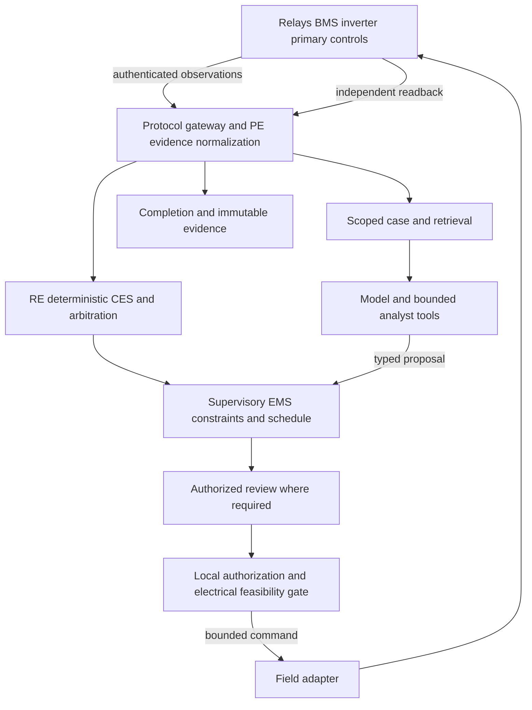

# Integrated microgrid architecture and control workflow

## Current acceptance scope

The [owner-approved acceptance scope](../../acceptance/scope.json) governs this active document: **all required hardware is simulated**, and **template/generic assets may be used in every case**. EI04 must provide templates for each asset class defined by the associated applicable standards, with edition/clause traceability; EI18 must verify a simulated counterpart for every hardware dependency. Generic reference parameters replace site-specific prerequisites for corpus admission. Actual software execution and genuine admission/reviewer evidence remain mandatory. Physical equipment certification and field commissioning are separate future activities. Historical research notes retain their original research context and do not override this decision.

Version 0.2.0 · 24 November 2026 · **PROPOSED_NOT_IMPLEMENTED**

The reference design is a US IEEE/NIST microgrid with selected IEC information exchange and equipment-specific profiles. It supports explicit site profiles; it does not assert compatibility with every protocol, jurisdiction or utility. Standards applicability and rights are recorded in [the standards inventory](../../standards-inventory.json). This document defines proposed project requirements, not claims of implemented controller behavior.

## Use NIST profiles across ownership boundaries

NIST SP 1108r4 identifies Customer, Markets, Service Provider, Operations, Generation Including DER, Transmission and Distribution in §2.1.2/Table 1, printed pp.15–16 (physical PDF pp.31–32). One organization can fill several roles. Its microgrid communication view in §2.2.5/Figure 8, printed pp.24–25 (physical pp.40–41), includes customer- and utility-managed microgrids and their cross-owner interfaces. Standards optionality alone does not ensure an interoperable pair; §6.5, printed pp.95–98 (physical pp.111–114), motivates a defined physical function, protocol and information-model subset. [NIST framework](https://doi.org/10.6028/NIST.SP.1108r4)

Instantiate [the profile template](../../templates/interoperability-profile.json) per conduit/device cohort. Freeze owners, exact edition/amendments, native protocol/encoding, security mechanism, functions/options, schema/point model, asset identifiers, units, phase/sign conventions, time/quality, precedence, transition states, measured deadlines, fallback and tests. Match the simulated device/software profile and declared generic utility role; real product certification is a separate future field concern. A catalog entry, a software build, a certified component, a communicating pair and a commissioned microgrid are distinct evidence levels.

## Keep protection, supervision and model assistance separate

Independent relays, synch-check, BMS and inverter primary controls own fast protection and inner loops. No model, broker, Internet feed or RE dispatch latency is a safety dependency. The deterministic supervisory controller owns schedules, network/thermal/reserve/ramp constraints and approved mode-transition requests. PE owns protocol adapters, structured provenance and normalized predicates; RE evaluates deterministic state/CES/arbitration, rather than reconstructing raw power-system physics from prose. Models retrieve, explain and propose; only typed approved bounded operations reach the local gate. Emergency behavior is engineered per mode, not an LLM-issued override.

## Cover the whole operating lifecycle

| Mode or transition | Required inputs and authority | Exit/readback and inhibited actions |
|---|---|---|
| Grid connected | Utility/PCC envelope, generation/load forecasts, DER capability, reserve, power quality, protection healthy | Verify measured P/Q and feeder limits; reject out-of-envelope export, aggregate ramps or stale-state dispatch |
| Planned island | Authorized procedure, PCC/switch feedback, grid-forming availability, reserve and critical-load plan | Confirm actual separation and stable island; do not assume request or ACK means islanded |
| Unplanned island | Independent protection/outage observations and local grid-forming design | Local controller stabilizes within approved limits; discretionary AI actions held until trustworthy state returns |
| Islanded | Local V/f reference, SOC/thermal/energy outlook, priority loads and generation capability | Enforce reserve and load-shed hierarchy; economic/carbon objectives cannot drop protected services |
| Black start, if supported | Approved de-energized state, grounding/LOTO/permit status, energy source, auxiliary power and engineered energization order | No energization without prerequisites and authorized procedure; capability explicitly disabled if unengineered |
| Resynchronizing | Utility permission, valid measurements/time quality, local synch-check, topology and breaker interlocks | No close without local permit and correct feedback; track reconnection ramp and stability |
| Recovery | Actual device/readback state, load/service continuity, alarms, cyber posture and unresolved commands | Independent closeout; unknown completion does not clear recovery; reassess current state before compensation |

All numerical values for voltage, frequency, angle, timing, holdover, ramp, SOC, reserve, retry and readback tolerances are **GENERIC_REFERENCE_PROFILE_REQUIRED**. Populate them from reviewed generic reference-scenario parameters and applicable normative requirements, explicitly distinguishing chosen assumptions from mandated values. IEEE 1547/1547.1, 2030.7/2030.8 are the proposed US interconnection/controller/test reference families, not universal values supplied by this package. [IEEE owner reference](https://sagroups.ieee.org/scc21/ieee-1547-series/)

## Make sensory and command workflows explicit

Each observation needs canonical site/asset/point identity; value, unit, scale, phase and sign; producer/authentication provenance; event and receipt timestamps; sequence; clock uncertainty/quality; calibration reference; source/topology/config revision; validity interval; measured/estimated/synthetic status; and missing/stale/conflicting reasons. Validate schema, calibration/range/plausibility and cross-sensor consistency before forming predicates. Retain last-known value with age; never map missing or stale evidence to healthy zero. Time-series/historian queries supply current facts; historical RAG chunks cannot stand in for live state.

Each command progresses through proposed, validated, authorized, accepted, applied, measuredComplete, rejected, expired, cancelled or completionUnknown. Define request IDs, ordering/priority, supersession/cancellation, replay handling and collision fencing. An authenticated device ACK proves receipt or acceptance at its specified layer, not physical completion. Readback should be independent where feasible, bind asset/action/time/dispatch, and show the commanded state or an explicit unresolved outcome. Broker QoS does not establish exactly-once physical execution. Cancellation has a last safe interruption point; a completed breaker operation or energy discharge cannot be undone by deleting a record.

The [DER supervisory example](../../examples/der-supervisory-profile.json) intentionally leaves engineering settings unset and is not executable configuration. Its AC06 cases must run actual selected software peer implementations against versioned simulated device endpoints; all engineering parameters are reviewed generic reference settings for corpus acceptance.
